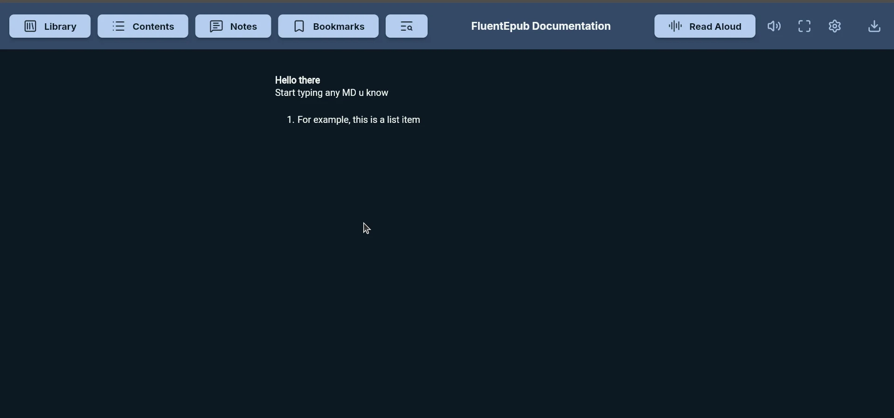

# Fluent Epub

Basically, ebook reader and editor ;) You can read your books, write new ones and keep everything organized in one place. No more jugglin between e-reader, notes app and word.

- WHAT YOU SEE IS WHAT YOU GET interface to edit EPUBS
- AI powered auto completions and grammar fixes
- Export options, mainly epub exports
- Normal Reading Interface
- Voice Reader
- Cross Platform

## Getting Started

### Dependencies

- Chrome/Chromium
- Flutter
- Dart

>Once it's running you can import your books and start reading or editing right away.

### Installing

`flutter pub get`

### Executing program

`flutter run -d chrome`

## More info

The project is split into two packages: the Flutter client app and a
Dart Frog backend server. Each has its own README with more details if
you want to dig deeper.

### [FrontEnd](/packages/client/README.md)

### [Backend](/packages/server/README.md)

## License

This project is licensed under the GPL-3.0 License - see the [LICENSE](LICENSE) file for details
